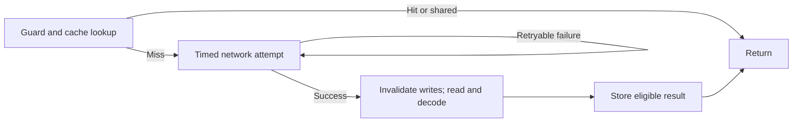

# Architecture

This guide explains the implementation boundaries and invariants of
`@dichovsky/testrail-api-client`. The package supplies an ESM SDK and a CLI.
Zod is its only runtime dependency.

For usage, read the [SDK guide](SDK.md), [CLI guide](CLI.md), or
[networking guide](NETWORKING.md). For setup, verification, and code conventions,
read [CONTRIBUTING.md](../CONTRIBUTING.md). For schema rules and endpoint or CLI
procedures, read [CLAUDE.md](../CLAUDE.md). [CODEMAP.md](../CODEMAP.md) is the symbol index.
[CONTEXT.md](../CONTEXT.md) defines domain terms.

- [Layers](#1-layered-view)
- [HTTP pipeline](#22-http-pipeline-requestt), [cache](#23-request-cache),
  [retries](#24-retry-policy-the-get--write-asymmetry), and [SSRF protection](#25-ssrf-guard--two-layers)
- [Lifecycle and transport ownership](#26-lifecycle)
- [Domain modules and pagination](#3-domain-modules--srcmodulests)
- [Schemas](#4-type-system--schemasts--typests) and [exports](#5-public-barrel--srcindexts)
- [CLI](#6-cli--srccli), [errors](#7-errors), and [tests](#8-testing--tests)

## 1. Layered view

| Layer              | Owner                                                            | Responsibility                                                                                  |
| ------------------ | ---------------------------------------------------------------- | ----------------------------------------------------------------------------------------------- |
| CLI                | `src/cli/`                                                       | Parse arguments, dispatch handlers, validate write payloads, render output, and manage file I/O |
| Public API         | `src/index.ts`                                                   | Export the client, errors, schemas, and types                                                   |
| Composition root   | `src/client.ts`                                                  | Bind domain modules to a shared core                                                            |
| Domain modules     | `src/modules/*.ts`                                               | Validate endpoint inputs and describe requests                                                  |
| Core               | `src/client-core.ts`                                             | Coordinate transport, rate limiting, retries, budgets, and lifecycle                            |
| Schemas and types  | `src/schemas/*.ts`, `src/types.ts`                               | Define payloads, expected responses, configuration, and query options                           |
| Supporting modules | `src/request-cache.ts`, `src/pagination.ts`, `src/validation.ts` | Own cache state, pagination, and preflight validation                                           |

`TestRailClient` composes 19 domain modules. Callers get access to endpoints through
these namespaces, for example `client.projects.getProject(id)`. Version 5.0.0 removed
the flat facade methods. [CHANGELOG.md](../CHANGELOG.md) has the migration map.

<a id="2-core--srcclient-corets"></a>

## 2. Core: `src/client-core.ts`

`TestRailClientCore` coordinates behavior across all modules. `RequestCache`
owns cache storage, request sharing, invalidation, and cleanup. The public barrel
exports neither class.

The sliding-window rate limiter stays in the core because admission runs
immediately before each fetch and shares retry and upstream-request counters.
A separate limiter would currently add only a pass-through wrapper. Move the limiter
into a separate module if it gets an independent admission policy.

### 2.1 Public surface

| Method                             | Purpose                                                                                                         |
| ---------------------------------- | --------------------------------------------------------------------------------------------------------------- |
| `request<T>(spec: RequestSpec<T>)` | HTTP entry point for JSON, text, binary, and multipart requests; owns response validation                       |
| `parse<T>()`                       | Public compatibility helper that validates response data separately                                             |
| `clearCache()` / `destroy()`       | Invalidate cached data or dispose the client                                                                    |
| `trackOperation<T>(callback)`      | Separate the callback `result` from the `settled` promise for transport cleanup; see [Lifecycle](#26-lifecycle) |
| `withTimeout(timeoutMs)`           | Declared on `TestRailClient` in `src/client.ts`: return a view with other timeouts that shares this core        |

Domain modules pass response schemas to `request()`. `request()` reports each mismatch
with the originating method and endpoint. On a mismatch, `request()` returns raw data
unless the hook throws.

The inherited `client.parse()` helper stays available for direct calls.
Domain methods do not call `client.parse()`. An override of `client.parse()` does not
change endpoint response validation.

`src/validation.ts` supplies preflight checks. `src/url.ts` builds endpoint paths
and query strings.

`RequestSpec<T>` in `src/http-pipeline-types.ts` describes the method, endpoint,
optional JSON or multipart body, schema, and response kind (JSON by default).
`deriveRetryPolicy()` derives retries from that structure and the optional
[request intent](../CONTEXT.md#request-intent). Callers cannot supply a retry
policy that accidentally enables multipart retries.

One `RequestBudget` (`src/request-budget.ts`) carries the optional `deadlineAt`
through each phase and retry. It clips timeouts, races promises, limits retry
delays, and produces HTTP 408 errors. Retries never reset the elapsed budget.

### 2.2 HTTP pipeline (`request<T>()`)

The core validates the request and does a cache lookup before it starts a loader.
Each network attempt has its own timer, DNS validation, and rate-limit admission.
The limiter admits each attempt one time.
If the response to a dispatched write succeeds, the write invalidates the cache before response decoding.
Otherwise, the write invalidates the cache as soon as the attempt fails.
The request cache stores a cacheable result only if no write changed the generation after the request started.



The diagram shows successful completion and retries. Each phase can also fail.
Redirects, timeouts, and body-limit failures stop the pipeline, and the client does not retry them.

| Boundary         | Invariant and reason                                                                                                                                                                            |
| ---------------- | ----------------------------------------------------------------------------------------------------------------------------------------------------------------------------------------------- |
| Request guard    | A destroyed client throws a plain `Error`. Invalid internal timeout or deadline parameters fail before I/O                                                                                      |
| URL and headers  | Build `{baseUrl}/index.php?/api/v2/{endpoint}` with Basic authentication. `User-Agent` uses `testrail-api-client/<version>` because npm scope characters are invalid in RFC 7230 product tokens |
| Attempt timer    | Start before DNS and stop after response headers. An uncancellable libuv lookup cannot extend the caller's timeout                                                                              |
| Body preparation | Serialize JSON or prepare multipart data before rate-limit admission                                                                                                                            |
| Admission        | A full sliding window rejects an initial attempt with synthetic `TestRailApiError(429, …)`. The local limiter records retries but does not reject them                                          |
| Redirect check   | Set `redirect: 'manual'`. `assertNotRedirect()` rejects each 3xx, stores `Location` in `error.response`, and prevents retries and caching                                                       |
| HTTP error       | Read the bounded error body, apply retry policy, then throw. Raw body text belongs only in `error.response`, never `error.message`                                                              |
| Write outcome    | After the client sends a write, clear stored and in-flight cache entries. Clear them before the read of a successful response (also an empty `204`), or as soon as the attempt fails            |
| Body read        | `readBodyWithLimits()` applies a byte limit and a separate wall-clock deadline. JSON decoding handles empty bodies, then does parsing and optional advisory validation                          |
| Transport error  | Convert `AbortError` to HTTP 408 without retry. Ordinary GET requests can retry network `TypeError` failures                                                                                    |

Response-like objects without `body.getReader()` use a fallback reader. The fallback
reader validates the size after the read completes. It applies the deadline during the
read. An uncancellable fallback read can continue in the background after the caller
times out.
See [SDK configuration](SDK.md#configuration) for limits and timeout controls.

### 2.3 Request cache

`RequestCache.resolve()` owns lookup, loading, and request sharing. Entries are
in an insertion-ordered `Map<string, { data, expiry }>`. Reads refresh the order, and
capacity eviction removes the oldest key. Entries and shared requests hold raw
JSON text snapshots. Each caller parses and decodes its own response. The cache never
passes transformed values through `structuredClone`.

| Key                          | Eligible response                         |
| ---------------------------- | ----------------------------------------- |
| `GET:{endpoint}`             | JSON GET without a schema                 |
| `PARSED:GET:{endpoint}`      | Schema-matched JSON GET                   |
| `PAGE:PARSED:GET:{endpoint}` | Strict page read (`cacheVariant: 'page'`) |

Separate namespaces keep raw, advisory list, and strict page responses apart.
The initiating decoder runs inside the upstream operation scope. Only a successful,
cacheable decode can publish the raw snapshot. A mismatch or a throwing hook cannot publish it.
The cache takes raw snapshots before the decoder runs. Thus, transforms cannot change data that the cache keeps for other callers.

Text, binary, non-GET, side-effecting reads, and `getAll*()` calls bypass caching.
Aggregate reads also bypass in-flight sharing.

`invalidate()` clears entries and in-flight references, then increments a
generation counter. An earlier GET can still return to its original caller but
cannot publish stale cache data. In-flight sharing works even when storage is
disabled, if the effective header and body timeouts match. Timeout views share
completed entries. The cache does not share a deadline-bounded in-flight request with
unbounded callers. When a bounded waiter times out, the cache does not cancel the shared request.

The expiry timer calls `unref?.()` so that the timer does not keep Node alive.
`MAX_NODE_TIMER_DELAY_MS` limits `cacheCleanupInterval` to prevent timer
overflow. A value of zero disables periodic cleanup. [Caching and retries](SDK.md#caching-and-retries)
explains application configuration and memory costs.

### 2.4 Retry policy (the GET / write asymmetry)

`src/retry-policy.ts` derives retry behavior from the request shape and intent.
The [SDK retry table](SDK.md#caching-and-retries) lists the policy for each request kind.

A dropped connection or 5xx response can occur after a write or report has
changed server state. A retry of such a request can duplicate the operation. HTTP 429 shows
that the server rate limiter rejected the request before execution. Multipart uploads never
retry, not even on 429, because the server possibly consumed part of the stream.

Backoff is `min(BASE_RETRY_DELAY_MS × 2^n, MAX_RETRY_DELAY_MS)`. The client uses a valid
`Retry-After` on any retryable HTTP response, also on GET 5xx. The value can be seconds
or an HTTP-date. The same maximum applies.
Missing, malformed, zero, negative, or expired values select exponential backoff.
Other 4xx responses and timeouts do not retry.

Multipart bodies accept `Blob`, `Uint8Array`, `File`, or `{ path, type?, fd? }`.
File descriptors use `node:fs.openAsBlob`, which streams the file and does not buffer the
full file. The CLI passes a descriptor for `--file`. File-open failures such as
`ENOENT`, `EACCES`, and `EISDIR` become `TestRailApiError(0, 'Network error: …')`.
[Lifecycle](#26-lifecycle) describes ownership and cleanup.

<a id="25-ssrf-guard--two-layers"></a>

### 2.5 SSRF guard: two layers

The constructor rejects private literals and `localhost` synchronously.
Before each fetch attempt, and before each retry, `awaitDnsValidation()` calls
`validatePublicHost()` with `dns.lookup({ all: true })`. The function validates each
returned address. Cache hits and shared waiters return before this lookup.

If the resolver fails, the client applies the network-error retry policy.
When the retry policy has no more retries, the client rejects the request with a network
`TestRailApiError` (`status: 0`). The client sends no request.

Both checks use one `net.BlockList` through `isPrivateHostLiteral` and
`isPrivateOrLoopbackIP`:

| Family      | Blocked ranges                                                                                                                                                                 |
| ----------- | ------------------------------------------------------------------------------------------------------------------------------------------------------------------------------ |
| IPv4        | Loopback, RFC 1918, CGNAT (`100.64.0.0/10`), link-local, `0.0.0.0/8`, benchmarking (`198.18.0.0/15`), multicast (`224.0.0.0/4`), reserved (`240.0.0.0/4`, including broadcast) |
| IPv6        | Unspecified, loopback, ULA, link-local, site-local, 6to4, NAT64 `64:ff9b::/96`, and local NAT64 `64:ff9b:1::/48`                                                               |
| Mapped IPv4 | IPv6 dotted and hex forms, such as `::ffff:127.0.0.1` and `::ffff:7f00:1`                                                                                                      |

`src/pinned-dispatcher.ts` connects through Node `http`/`https` and uses only the
validated DNS snapshot. It does no second OS lookup. It keeps the hostname
for `Host`, TLS SNI, and certificate verification. The validated address set is the key
of each socket pool. Native fetch still handles multipart encoding, response
decompression, and redirect detection.

HTTPS is required unless `allowInsecure` is enabled. All redirects stay
blocked. `allowPrivateHosts` disables both DNS validation and DNS pinning.
A custom fetch must use the supplied dispatcher or apply equivalent
destination, abort, and redirect rules. The dispatcher connects directly and
bypasses Undici global proxy dispatchers. Local validation cannot control the DNS
decisions of a proxy.

See [private servers](NETWORKING.md#private-servers),
[custom DNS resolvers](NETWORKING.md#custom-dns-resolvers), and
[proxies and certificate authorities](NETWORKING.md#proxies-and-custom-certificate-authorities)
for configuration and adapter examples.

### 2.6 Lifecycle

The constructor registers each client in `activeClients`. `destroy()` is
idempotent. It sets `isDestroyed`, disposes the cache, clears credentials, and
removes the client from `activeClients`. `destroy()` does not abort in-flight requests.

Process handlers are opt-in. The package installs them only one time per process, and they stay for the
process lifetime. They destroy all active clients on `exit`, `SIGINT`, or `SIGTERM`.
`SIGINT` exits with code 130, and `SIGTERM` exits with code 143. The CLI enables the
handlers in `src/cli.ts`, outside `runCli`. Thus, in-process tests do not install permanent
handlers. [SDK lifecycle](SDK.md#lifecycle) explains application shutdown.

`trackOperation(callback)` separates the callback's `result` from its
non-rejecting `settled` promise, which waits for child transport work and cleanup.
`src/operation-tracking.ts` uses `AsyncLocalStorage` to isolate concurrent and
nested operations. Each cache loader owns a tracking scope. Shared callers wait
until that scope settles. The client registers DNS, fetch, retry timers, body reads, and
cancellation before any timeout race. Thus, a caller-visible timeout cannot release
ownership of unfinished I/O.

The first `trackOperation` call enables tracking for the process lifetime. Tracking
activates `AsyncContextFrame` across the process. Before that call,
`startOperation().settled` follows only the callback. An already-running request
can later share its result but cannot retroactively track post-result cleanup.
Multipart uploads also use an asynchronous context in `src/upload-transport.ts`
to associate native diagnostic events with the upload attempt.

`src/upload-lifetime.ts` owns each multipart upload from SDK method entry through cleanup.
It accepts the supplied descriptor before ID validation, request validation, and client-state checks.
Nested request calls share that owner and do not mutate the caller's input.
The core keeps DNS checks, deadlines, rate-limit admission, and response handling.
Body preparation completes before admission. The client sends the body one time, after admission.

`src/upload-source.ts` does path normalization, `openAsBlob` calls, `FormData` construction,
stream wrapping, and file closure for the upload owner.
A source cannot build again after its first build or release.

The owner aborts the transport. Before it closes the wrappers normally, it requires evidence that transmission stopped.
For HTTP/1, it destroys a socket only if that socket still belongs to the request.
For HTTP/2, it destroys only the matching stream and keeps the shared session.

Confirmation can be missing, for example when a custom fetch ignores the abort. Then the wrappers fail with an error.
Thus, the encoder cannot complete a truncated file with a valid multipart boundary.
Cleanup always removes transport observers and releases the supplied descriptor.

Neither tracking nor disposal cancels a workflow. Callers must return the full
promise of the workflow from the tracking callback. Unawaited application timers are
outside the scope. Transport cleanup that never completes keeps `settled` pending.

<a id="3-domain-modules--srcmodulests"></a>

## 3. Domain modules: `src/modules/*.ts`

Each stateless namespace holds a reference to the shared core. The table maps
module files to their responsibilities. Some modules group several TestRail resources.

| Module              | Domain                                                              |
| ------------------- | ------------------------------------------------------------------- |
| `projects.ts`       | Projects                                                            |
| `suites.ts`         | Test suites                                                         |
| `sections.ts`       | Sections and moves                                                  |
| `cases.ts`          | Cases, bulk operations, soft deletion, and history                  |
| `plans.ts`          | Plans, entries, and runs within entries                             |
| `runs.ts`           | Runs, closing, and soft deletion                                    |
| `tests.ts`          | Tests within runs                                                   |
| `results.ts`        | Per-test, per-case, and batch results                               |
| `milestones.ts`     | Milestones                                                          |
| `users.ts`          | Users and groups                                                    |
| `metadata.ts`       | Statuses, priorities, case/result fields, case types, and templates |
| `configurations.ts` | Configuration groups and configurations                             |
| `attachments.ts`    | Binary uploads, lists, downloads, and deletion                      |
| `bdd.ts`            | BDD scenarios; text responses use `responseKind: 'text'`            |
| `labels.ts`         | Labels                                                              |
| `sharedSteps.ts`    | Shared steps and history                                            |
| `variables.ts`      | Project variables                                                   |
| `datasets.ts`       | Datasets                                                            |
| `reports.ts`        | Report lists and execution                                          |

### 3.1 Composition pattern

Modules receive `TestRailClientCore` through constructor injection:

```typescript
constructor(private readonly client: TestRailClientCore) {}
```

Each endpoint method validates IDs and filters through `src/validation.ts` and
`src/url.ts`. Then it calls `this.client.request<T>({ …, schema })`. Modules own no
other state. To add an endpoint, see the [endpoint procedure](../CLAUDE.md#common-tasks).

<a id="32-composition-root--srcclientts"></a>

### 3.2 Composition root: `src/client.ts`

`TestRailClient` extends the core, builds `createModuleBindings(this)`, and
assigns its `public readonly` module fields. `withTimeout()` reuses the binding
map through `Object.assign` without proxies or prototype mutation.
`tests/exports.test.ts` tests the module inventory and timeout-view parity.

`tests.getTest(id, { withData: '1' })` separates advisory entity validation from
strict wrapper normalization. The wrapper needs a `test` object. Null or omitted
`results` and `attachments` become `[]`, even when a test field does not match its
schema. Scalar collections or a malformed wrapper throw `TestRailApiError`,
unless a strict mismatch hook throws first.

### 3.3 Pagination projections

A pagination descriptor in `docs/testrail-endpoints.json` gives an endpoint three projections:

- `get*()` for items.
- `get*Page()` for envelope metadata.
- `getAll*()` for a bounded aggregate.

`src/cli/metadata/paginated-endpoints.ts` mirrors these descriptors.
See [SDK pagination](SDK.md#pagination) for usage and limits.

Each module's typed descriptor has a synchronous `prepare()` adapter that
validates IDs and filters and returns `{ operation, pathParameters, query }`.
`createPaginatedListExecutor()` in `src/modules/paginated-list.ts` validates the
operation, clones and freezes inputs, builds paths, and prepares list/page schemas
one time. Aggregate helpers in `src/modules/pagination-options.ts` copy only
page controls and safety limits. With `requestControls: false`, the helpers copy only safety
limits. Extra properties never enter requests.

`parsePaginationContinuation()` reads only validated `offset` and optional
`limit` from `_links.next`. It discards the supplied host and path. Then it rebuilds
the endpoint with the original validated parameters and filters. A bare array
stops pagination after one page. Aggregates never return partial results. Invalid pages,
continuations, non-progress, or exceeded bounds throw `TestRailPaginationError`.

The 24 registered endpoints appear in the [SDK endpoint list](SDK.md#pagination),
with their request-control exceptions. This set includes project BDDs and labels.
`tests/pagination-descriptor-inventory.test.ts` compares the keys, response shapes,
and 18/6 `requestControls` split with the endpoint inventory.

<a id="4-type-system--schemasts--typests"></a>

## 4. Type system: `schemas/*.ts` + `types.ts`

| Concern                                         | Source                                                             |
| ----------------------------------------------- | ------------------------------------------------------------------ |
| Write payloads and expected response shapes     | Zod schemas in `src/schemas/*.ts`                                  |
| Public response aliases and custom-field access | `KnownResponse` aliases in `src/types.ts`, derived from schemas    |
| Configuration                                   | Types in `src/types.ts`, runtime schema in `src/schemas/common.ts` |
| Query options (`Get*Options`)                   | DTOs in `src/types.ts` and `src/modules/*.ts`                      |

`src/schemas.ts` re-exports domain schemas. The code infers payload types from Zod,
so that SDK types and CLI validation agree. Response aliases expose declared keys.
At runtime, `zObject = z.object(shape).passthrough()` keeps unknown fields.
Only `Case`, `Test`, and `Result` expose a `custom_*` index with the type `unknown`.
The nested `custom_fields` property is deprecated.

`TestRailConfigSchema` validates the runtime shape and ranges. Its shape uses `satisfies`
against `TestRailConfig`. `validateTestRailConfig()` applies URL security rules. Both
use `TESTRAIL_CONFIG_EMAIL_PATTERN` and the Node timer limit. Strict request
pagination uses `PaginationRequestSchema`. The deprecated `PaginationSchema`
alias keeps its earlier behavior.

Schemas include observed fields such as `Test.refs_data`, case titles/references,
case/result field system flags, writable case-field indexing, and recursive
`Milestone.milestones`. When you change the schemas, follow the
[schema conventions](../CLAUDE.md#schema-authoring-conventions-srcschemasts). [Response validation](SDK.md#response-validation) and
[custom fields](SDK.md#custom-fields) explain the caller-facing contract.

<a id="5-public-barrel--srcindexts"></a>

## 5. Public barrel: `src/index.ts`

The barrel exports `TestRailClient`, error classes and `handleZodError`, Zod
schemas, payload/response/option types, module class types, request-spec types,
pagination types, and public pagination limits. [CODEMAP.md](../CODEMAP.md) contains the exact symbol inventory.

The core, collector helpers, and internal constants stay private. The barrel exports
the 19 domain module classes only as types, with `KnownResponse`,
`RequestSpec`, `RequestBody`, and `RequestIntent`. A consumer that emits
declarations can then name `client.<module>`, the response types, and the
argument of `client.request()`. Only `TestRailClient` constructs the module
classes. Callers use domain modules through client fields.

The barrel does not export CLI internals. The `./cli` subpath is the executable
entry point and exports nothing. If you import the subpath, the CLI runs in the importing
process and sets `process.exitCode`.

<a id="6-cli--srccli"></a>

## 6. CLI: `src/cli/`

`package.json` exposes the `testrail` executable. Its `./cli` subpath resolves to
the same file, `dist/cli.js`. Do not import that subpath as a module. Run the
executable. The [CLI guide](CLI.md) describes command usage and flag behavior.

### 6.1 Entrypoint chain

`src/cli.ts` builds `CliRuntime`, supplies process streams, installs signal
handling, and assigns `process.exitCode`. Then it calls the testable
`src/cli/index.ts:runCli(runtime)`, which does these steps:

1. Parse argv with Node `parseArgs` (`strict: false`). Validate each token
   against `KNOWN_FLAGS` and its primitive type. This validation runs before help or version output too.
2. Short-circuit help/version or validated skill installation/removal. A known
   leading resource limits help to that resource. Otherwise, help lists all resources.
3. Dispatch the action. Resolve allowed and required flags, path count,
   pagination, diagnostic platform support, response mode, and destructive gates.
4. If requested, read an API key from stdin. Resolve authentication (flags
   override environment). Create the lazy `BodyInput.readStdin`. Parse the timeout.
5. Enter `withDiagnostics(request, deps, work)`. Reserve its file, except for a dry run.
   Register cleanup. Construct the client. Mark dispatch. Await the handler.
6. Destroy the client before diagnostic finalization. On failure, report the error and
   write a record. Then throw the original error again. Always remove the exit listener.
   Always complete or remove the reservation.

Per-occurrence validation finds a swallowed flag, even if a later repetition
supplies a valid value. Inline `--filter=--all` is a valid literal. Negative
numbers, `-`, and `--` also stay valid string values.

<a id="62-dispatch--srcclidispatchts"></a>

### 6.2 Dispatch: `src/cli/dispatch.ts`

At module load, dispatch derives `ACTION_SPECS` and `RESOURCES` from `ACTIONS`.
Each spec owns its handler, so there is no second handler table.
`dispatch(resource, action)` returns a tagged success/error union. The union has
different errors for unknown resources and unknown actions.

<a id="63-metadata--srcclimetadatats"></a>

### 6.3 Metadata: `src/cli/metadata.ts`

`ACTIONS: readonly ActionSpec[]` combines per-resource metadata. Each spec names
the resource/action, summary, handler, path parameters, API endpoint, flags, and
optional body schema. Capability fields describe file input/output, output kind,
writes, destructive actions, and optional soft deletion. Shared flag groups come
from capabilities. The CLI finds the pagination configuration separately through `apiEndpoint`.

Five consumers share this catalog: dispatch, help, the skill generator, the API
mapping generator, and `resolveActionInvocation()`. Help also uses
`CLI_OPTION_DOCUMENTATION` from `flags.ts`. The mapping generator compares the endpoint
metadata with the `@testrail` JSDoc tags. It requires each endpoint method to have a CLI action.

<a id="64-handler-conventions--srcclihandlers"></a>

### 6.4 Handler conventions: `src/cli/handlers/`

Each `Handler` receives a `HandlerContext` with the spec, client, projected
arguments, pagination, body input, binary stdin, execution flags, and output writers.

| Handler       | Execution order                                                                                                               |
| ------------- | ----------------------------------------------------------------------------------------------------------------------------- |
| Read          | Parse positive IDs with `parseId`, then call the SDK and output. Lists use `outputPaginated()` with typed per-module closures |
| Write factory | Parse IDs, resolve and validate the body, return a dry-run preview if requested, then call the SDK                            |
| Destructive   | Parse inputs, validate soft-mode support, return a dry-run preview if requested, require confirmation, then call the SDK      |

Destructive handlers validate their inputs before they call `executeDestructive()` in `destructive.ts`.
Both the factory and custom handlers use this workflow for soft-mode checks, dry-run, confirmation, and successful output.
Their callbacks define the preview, SDK call, and result format. They do not repeat the execution gates.

Explicit closures let TypeScript validate list-method signatures.
`createWriteHandler()` uses `resolveBody()`. With `allowEmptyBody`, an omitted
body defaults to `{}`. Custom handlers are for irregular actions such as bulk case deletion,
attachment uploads/deletion, and group creation.

`setupUpload()` passes `read: !ctx.dryRun` to `resolveFile()` so that previews do not drain binary stdin.
Download handlers parse IDs. Then they call `outputDownload()` with a lazy SDK callback.
`outputDownload()` validates the destination before the fetch, handles previews, and routes text or binary content through the existing output and safe-write functions.
Contributor procedures for new handlers are in [CLAUDE.md](../CLAUDE.md#common-tasks).

`CliRuntime.stdin` supplies terminal status and separate text and binary readers.
Text reads stay synchronous, and binary reads apply their own byte cap and deadline.
`src/cli.ts` supplies the real stream and descriptor. Other modules receive these inputs explicitly.
Upload handlers pass the binary reader through `HandlerContext`, `setupUpload()`, and `resolveFile()`.
Tests supply independent input streams and do not replace process globals.

### 6.5 Cross-cutting CLI infrastructure

| Owner in `src/cli/`                      | Responsibility                                                                                            |
| ---------------------------------------- | --------------------------------------------------------------------------------------------------------- |
| `auth.ts`, `ids.ts`                      | Authentication resolution and integer parsing                                                             |
| `flags.ts`, `action-invocation.ts`       | Flag catalog, token checks, capability projections, and allowed/required flags before auth or file writes |
| `help.ts`                                | Render global and per-resource `--help` text from `ACTIONS` and the option catalog                        |
| `filters.ts`                             | Parse optional ID, ID-list, boolean, and `--refs` list filters for read handlers                          |
| `pagination.ts`                          | Validate modes/controls before client construction and select item, page, or aggregate output             |
| `body.ts`, `stdin.ts`                    | Select JSON input, limit explicit text and binary readers, and validate write payloads                    |
| `file-input.ts`                          | Require regular upload files and select file or injected binary stdin input                               |
| `file-output.ts`, `safe-write.ts`        | Validate download destinations and write through a held descriptor                                        |
| `upload.ts`, `download.ts`               | Own the upload and download workflows: dry-run previews, lazy transfer, and output routing                |
| `destructive.ts`                         | Own soft-mode checks, dry-run, confirmation, and successful output for delete and close commands          |
| `response-validation.ts`                 | Build redacted, deduplicated schema-mismatch warnings or strict errors                                    |
| `diagnostics.ts`                         | Reserve private files, redact failure records, and own finalization                                       |
| `output.ts`, `sanitize.ts`               | Format output and strip terminal control characters                                                       |
| `handler-context.ts`                     | Define handler inputs and injected writers                                                                |
| `install-skill.ts`, `uninstall-skill.ts` | Stage bundled skill files before replacement; keep user-added files on removal                            |

Mismatch warnings contain only the method, the resource/action, issue codes, and masked
path depth. They do not include URLs, field names, or values. Fingerprint deduplication and
the warning cap prevent large numbers of warnings. Strict reads fail validation. Strict writes report
an indeterminate outcome. [CLI response validation](CLI.md#response-validation)
describes mode selection and warning behavior.

The CLI reserves the diagnostic file before client construction. Windows rejects the feature
before stdin and authentication. A dry run skips the reservation.

Dispatch tracking changes `operationOutcome` from `not_dispatched` to `failed_or_indeterminate`
before the CLI calls the handler. Thus, a local handler failure cannot show that
no API write occurred. Record extraction accepts only bounded, structured
validation details. It does not include raw bodies, headers, payloads, or stacks.

On macOS, `diagnostics.ts` clears inherited ACLs on a private staging directory
before it creates the file. Then it links that file exclusively to the requested path.
Bounded `chmod` calls make the staging directory private and clear ACLs added to the
file before output. File ACL removal uses the held descriptor through `/dev/fd/3`.
Thus, a path replacement cannot redirect `chmod`. The destination directory keeps its
ACL.

A failure rejects the destination or omits the record. Cleanup and diagnostic
failures do not change the exit status of the command. See
[diagnostic files](CLI.md#diagnostic-files) for the record format and user workflow.

### 6.6 `--dry-run`, `--yes`, `--soft`, `TESTRAIL_ALLOW_DESTRUCTIVE` semantics

`checkDestructiveEnvGate()` validates the exact environment value `'1'` before
authentication. A failure exits with code 2. Handlers validate confirmation after the
dry-run branch. If `--yes` is missing, the CLI exits with code 1. Both gates are CLI-only.

A dry run bypasses both gates and returns locally. Soft deletion sends a real
request and requires both gates. `ActionSpec.softMode` sets soft-mode support.
A dry run with `--soft` or `--yes` still sends no request. See
[destructive actions](CLI.md#destructive-actions) for supported commands.

### 6.7 Output ownership

Only `src/cli.ts` can reference `process.stdout`, `process.stderr`, or
`process.argv`. Oxlint applies this rule. `createOutput()` requires explicit writers,
and handlers receive all five through `HandlerContext`:

| Writer       | Stream and behavior                                                                                |
| ------------ | -------------------------------------------------------------------------------------------------- |
| `out`        | Formatted stdout, suppressed by quiet                                                              |
| `outRaw`     | Preformatted stdout, suppressed by quiet                                                           |
| `outPayload` | Downloaded content on stdout, acknowledgement on stderr; quiet suppresses only the acknowledgement |
| `err`        | Sanitized stderr with `Error: ` prefix, suppressed by quiet                                        |
| `errRaw`     | Raw stderr, suppressed by quiet; caller must sanitize                                              |

`outPayload` warns when it writes `Uint8Array` binary content to a terminal. It never
warns for strings. `sanitizeForTerminal` strips C0, DEL, and C1 controls.

File output uses exclusive creation (`wx`) by default. With force, the CLI opens the file
without truncation. It validates that the file is a regular file with a matching path identity.
Then it truncates the file and writes through the same descriptor. The CLI rejects device nodes,
FIFOs, and symlinks.

`tests/cli-output-ownership.test.ts` tests injected writers and quiet behavior.
[CLI output](CLI.md#output-and-exit-codes) explains usage.

## 7. Errors

[SDK error handling](SDK.md#error-handling) describes the public classes and catch
order. The implementation keeps entity mismatches separate from protocol errors:

| Failure                                                  | Result                                                          |
| -------------------------------------------------------- | --------------------------------------------------------------- |
| Entity-field mismatch                                    | Advisory raw data and optional hook; never cached               |
| Missing/scalar default-list collection                   | `TestRailApiError`                                              |
| HTTP 403 that reports an Enterprise-license restriction  | `TestRailLicenseError`, a `TestRailApiError` subclass           |
| Invalid page, continuation, progress, or aggregate bound | `TestRailPaginationError`, a `TestRailValidationError` subclass |
| Invalid caller input                                     | `TestRailValidationError`                                       |
| Request after disposal                                   | Plain `Error`                                                   |

A throwing mismatch hook runs before list/page decoders. A failed write response
or hook is never evidence that the server did not execute the write.

<a id="8-testing--tests"></a>

## 8. Testing: `tests/`

Vitest tests apply the boundaries above. In-process CLI tests call `runCli()`.
`scripts/package-smoke.ts` runs the packed executable in child processes on all
CI platforms. [CONTRIBUTING.md](../CONTRIBUTING.md) owns verification commands.

| Tests                                                              | Boundary covered                                                                                    |
| ------------------------------------------------------------------ | --------------------------------------------------------------------------------------------------- |
| `client-endpoints`, `exports`, `architecture-inventory`            | Endpoint behavior, public/module inventory, and timeout views                                       |
| `client-features`, `request-cache`, `performance`                  | Cache integration, cloning, TTL/LRU, sharing, generations, budgets, lifecycle, and throughput       |
| `client-edge-cases`, `client-ssrf-coverage`, `body-limits`         | Signals, redirects, address classification, and body bounds                                         |
| `pagination-core`, `pagination-descriptor-inventory`               | Safe continuation, decoding, bounds, deadlines, and endpoint registrations                          |
| `cli`, `cli-action-invocation`, `cli-pagination`, `cli-helpers`    | Dispatch, authentication, flag parsing, output, and exit codes                                      |
| `cli-write-handlers`, `cli-attachment-handlers`, `payload-schemas` | Write validation, dry-run, path parameters, file I/O, confirmation, and custom fields               |
| `cli-diagnostic*`, `cli-output-ownership`                          | Redaction, private files, path races, ACLs, signal cleanup, and injected output                     |
| `case-field-readiness`                                             | GET-only polling, identity/configuration checks, cancellation, deadlines, and kept creation results |

## 9. Generated artifacts

`CODEMAP.md`, `docs/API-MAPPING.md`, `AGENTS.md`, and generated skill sections
are committed generated files from source-driven generators. Verification and CI compare
fresh renders with the committed files.

| Script in `scripts/`                                                      | Responsibility                                                             |
| ------------------------------------------------------------------------- | -------------------------------------------------------------------------- |
| `generate-codemap.ts`                                                     | Render `CODEMAP.md` from the TypeScript AST                                |
| `generate-mapping.ts`, `mapping-renderer.ts`, `action-metadata-parser.ts` | Render `docs/API-MAPPING.md` and run the mapping gates                     |
| `generate-skill.ts`, `skill-renderer.ts`                                  | Render the generated skill sections and the payload-schema reference       |
| `generate-agents-md.ts`, `rules-content.ts`                               | Render `AGENTS.md` from `ACTIONS` and the shared rules text                |
| `ts-source.ts`                                                            | Parse source for the generators through the TypeScript 7 API               |
| `build.ts`                                                                | Remove `dist/` and compile the production build                            |
| `check-published-versions.ts`                                             | Compare the published-version list in `CHANGELOG.md` with `package.json`   |
| `package-smoke.ts`                                                        | Install the packed tarball in a temporary consumer and run the SDK and CLI |
| `release-preflight.ts`                                                    | Check release identity and registry state in the publish workflow          |

See [CONTRIBUTING.md](../CONTRIBUTING.md#generated-files) for
source ownership and generator commands. See [CLAUDE.md](../CLAUDE.md#api-coverage-matrix)
for the mapping gates.

## 10. Invariants worth preserving

Use the boundary tables above when you review changes:

- [Pipeline ordering](#22-http-pipeline-requestt): DNS before fetch, manual
  redirects, bounded body reads, and write invalidation before decoding.
- [Cache ownership](#23-request-cache): namespace isolation, cloning, matching
  timeout policies, and invalidation generations.
- [Retry policy](#24-retry-policy-the-get--write-asymmetry): do not duplicate
  writes, reports, or partially consumed uploads.
- [Transport settlement](#26-lifecycle): a returned timeout does not release
  ownership of unfinished I/O.
- [Pagination](#33-pagination-projections): reconstruct continuations and
  collect fresh pages within bounds.
- [CLI dispatch](#61-entrypoint-chain) and [output](#67-output-ownership): validate
  before side effects, keep dry-run precedence, and use held descriptors.

## 11. Conventions in one place

[CONTRIBUTING.md](../CONTRIBUTING.md) owns setup, verification, code conventions,
and regeneration. [CLAUDE.md](../CLAUDE.md) owns the schema-authoring rules and the
endpoint and CLI procedures. [AGENTS.md](../AGENTS.md) is the generated summary of
these rules for coding agents.
