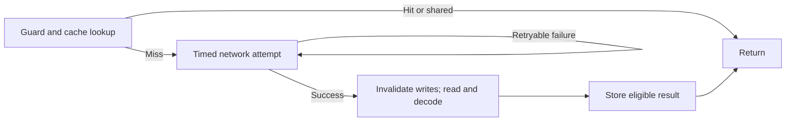

# Architecture

This guide explains the implementation boundaries and invariants of
`@dichovsky/testrail-api-client`. The package provides an ESM SDK and CLI, with
Zod as its only runtime dependency.

For usage, read the [SDK guide](SDK.md), [CLI guide](CLI.md), or
[networking guide](NETWORKING.md). For contributor procedures, read
[CONTRIBUTING.md](../CONTRIBUTING.md). [CODEMAP.md](../CODEMAP.md) indexes symbols;
[CONTEXT.md](../CONTEXT.md) defines domain terms.

- [Layers](#1-layered-view)
- [HTTP pipeline](#22-http-pipeline-requestt), [cache](#23-request-cache),
  [retries](#24-retry-policy-the-get--write-asymmetry), and [SSRF protection](#25-ssrf-guard--two-layers)
- [Lifecycle and transport ownership](#26-lifecycle)
- [Domain modules and pagination](#3-domain-modules--srcmodulests)
- [Schemas](#4-type-system--schemasts--typests) and [exports](#5-public-barrel--srcindexts)
- [CLI](#6-cli--srccli), [errors](#7-errors), and [tests](#8-testing--tests)

## 1. Layered view

| Layer              | Owner                                                            | Responsibility                                                                                  |
| ------------------ | ---------------------------------------------------------------- | ----------------------------------------------------------------------------------------------- |
| CLI                | `src/cli/`                                                       | Parse arguments, dispatch handlers, validate write payloads, render output, and manage file I/O |
| Public API         | `src/index.ts`                                                   | Export the client, errors, schemas, and types                                                   |
| Composition root   | `src/client.ts`                                                  | Bind domain modules to a shared core                                                            |
| Domain modules     | `src/modules/*.ts`                                               | Validate endpoint inputs and describe requests                                                  |
| Core               | `src/client-core.ts`                                             | Coordinate transport, rate limiting, retries, budgets, and lifecycle                            |
| Schemas and types  | `src/schemas/*.ts`, `src/types.ts`                               | Define payloads, expected responses, configuration, and query options                           |
| Supporting modules | `src/request-cache.ts`, `src/pagination.ts`, `src/validation.ts` | Own cache state, pagination, and preflight validation                                           |

`TestRailClient` composes 19 domain modules. Callers reach endpoints through
these namespaces, such as `client.projects.getProject(id)`. Flat facade methods
were removed in version 5.0.0; [CHANGELOG.md](../CHANGELOG.md) has the migration map.

<a id="2-core--srcclient-corets"></a>

## 2. Core: `src/client-core.ts`

`TestRailClientCore` coordinates behavior across all modules. `RequestCache`
owns cache storage, request sharing, invalidation, and cleanup. Neither class
is exported from the public barrel.

The sliding-window rate limiter stays in the core because admission runs
immediately before each fetch and shares retry and upstream-request counters.
A separate limiter would currently add only a pass-through wrapper. Extract it
if it gains an independent admission policy.

### 2.1 Public surface

| Method                             | Purpose                                                                                   |
| ---------------------------------- | ----------------------------------------------------------------------------------------- |
| `request<T>(spec: RequestSpec<T>)` | HTTP entry point for JSON, text, binary, and multipart requests; owns response validation |
| `parse<T>()`                       | Public compatibility helper for separately validating response data                       |
| `clearCache()` / `destroy()`       | Invalidate cached data or dispose the client                                              |

Domain modules pass response schemas to `request()`. It reports mismatches with
the originating method and endpoint. A mismatch returns raw data unless the hook throws.
The inherited `client.parse()` helper remains available for direct calls.
Domain methods do not call it; overriding it does not customize endpoint response validation.
`src/validation.ts` supplies preflight checks; `src/url.ts` builds endpoint paths
and query strings.

`RequestSpec<T>` in `src/http-pipeline-types.ts` describes the method, endpoint,
optional JSON or multipart body, schema, and response kind (JSON by default).
`deriveRetryPolicy()` derives retries from that structure and the optional
[request intent](../CONTEXT.md#request-intent). Callers cannot supply a retry
policy that accidentally enables multipart retries.

One `RequestBudget` (`src/request-budget.ts`) carries the optional `deadlineAt`
through every phase and retry. It clips timeouts, races promises, bounds retry
delays, and produces HTTP 408 errors; retries never reset the elapsed budget.

### 2.2 HTTP pipeline (`request<T>()`)

The core checks the request and consults the cache before starting a loader.
Each network attempt has its own timer, DNS validation, and rate-limit
admission. Successful writes invalidate the cache before response decoding.
A cacheable result is stored only if no intervening write changed the generation.



The diagram shows successful completion and retries. Every phase can also fail;
redirects, timeouts, and body-limit failures leave the pipeline without retrying.

| Boundary         | Invariant and reason                                                                                                                                                                            |
| ---------------- | ----------------------------------------------------------------------------------------------------------------------------------------------------------------------------------------------- |
| Request guard    | A destroyed client throws a plain `Error`; invalid internal timeout or deadline parameters fail before I/O                                                                                      |
| URL and headers  | Build `{baseUrl}/index.php?/api/v2/{endpoint}` with Basic authentication. `User-Agent` uses `testrail-api-client/<version>` because npm scope characters are invalid in RFC 7230 product tokens |
| Attempt timer    | Start before DNS and stop after response headers. An uncancellable libuv lookup cannot extend the caller's timeout                                                                              |
| Body preparation | Serialize JSON or prepare multipart data before rate-limit admission                                                                                                                            |
| Admission        | A full sliding window rejects an initial attempt with synthetic `TestRailApiError(429, …)`. Retries are recorded but not rejected by the local limiter                                          |
| Redirect check   | Set `redirect: 'manual'`; `assertNotRedirect()` rejects every 3xx, stores `Location` in `error.response`, and prevents retries and caching                                                      |
| HTTP error       | Read the bounded error body, apply retry policy, then throw. Raw body text belongs only in `error.response`, never `error.message`                                                              |
| Successful write | Clear stored and in-flight cache entries before reading or parsing the response, including empty `204` responses                                                                                |
| Body read        | `readBodyWithLimits()` enforces bytes and a separate wall-clock deadline. JSON decoding handles empty bodies, then parsing and optional advisory validation                                     |
| Transport error  | Convert `AbortError` to HTTP 408 without retry; ordinary GET requests can retry network `TypeError` failures                                                                                    |

Response-like objects without `body.getReader()` use a fallback reader. It
checks size after completion but enforces the deadline while reading. An
uncancellable fallback can continue in the background after the caller times out.
See [SDK configuration](SDK.md#configuration) for limits and timeout controls.

### 2.3 Request cache

`RequestCache.resolve()` owns lookup, loading, and request sharing. Entries live
in an insertion-ordered `Map<string, { data, expiry }>`; reads refresh order and
capacity eviction removes the oldest key. Both reads and writes use
`structuredClone`, so callers cannot mutate cached data.

| Key                          | Eligible response                         |
| ---------------------------- | ----------------------------------------- |
| `GET:{endpoint}`             | JSON GET without a schema                 |
| `PARSED:GET:{endpoint}`      | Schema-matched JSON GET                   |
| `PAGE:PARSED:GET:{endpoint}` | Strict page read (`cacheVariant: 'page'`) |

Separate namespaces keep raw, advisory list, and strict page responses apart.
A mismatch returns `cacheable: false`, so later calls fetch and report it again.
Text, binary, non-GET, side-effecting reads, and `getAll*()` calls bypass caching;
aggregate reads also bypass in-flight sharing.

`invalidate()` clears entries and in-flight references, then increments a
generation counter. An earlier GET can still return to its original caller but
cannot publish stale cache data. In-flight sharing works even with storage
disabled, provided effective header and body timeouts match. Timeout views share
completed entries; deadline-bounded requests are not published to unbounded
callers, and bounded waiters can time out without cancelling a shared request.

The expiry timer calls `unref?.()` so it does not keep Node alive.
`cacheCleanupInterval` is bounded by `MAX_NODE_TIMER_DELAY_MS` to prevent timer
overflow; zero disables it. [Caching and retries](SDK.md#caching-and-retries)
covers application configuration and memory costs.

### 2.4 Retry policy (the GET / write asymmetry)

`src/retry-policy.ts` derives retry behavior from the request shape and intent.
The [SDK retry table](SDK.md#caching-and-retries) lists the policy for each request kind.

A dropped connection or 5xx response can occur after a write or report already
changed server state. Retrying it can duplicate the operation. HTTP 429 indicates
rejection by the server rate limiter before execution. Multipart uploads never
retry, including on 429, because the server may have consumed part of the stream.

Backoff is `min(BASE_RETRY_DELAY_MS × 2^n, MAX_RETRY_DELAY_MS)`. A valid
`Retry-After` on any retryable HTTP response, including GET 5xx, accepts seconds
or an HTTP-date, with the same maximum.
Missing, malformed, zero, negative, or expired values select exponential backoff.
Other 4xx responses and timeouts do not retry.

Multipart bodies accept `Blob`, `Uint8Array`, `File`, or `{ path, type? }`.
File descriptors use `node:fs.openAsBlob`, which streams without buffering the
whole file. The CLI passes a descriptor for `--file`; file-open failures such as
`ENOENT`, `EACCES`, and `EISDIR` become `TestRailApiError(0, 'Network error: …')`.
[Lifecycle](#26-lifecycle) describes ownership and cleanup.

<a id="25-ssrf-guard--two-layers"></a>

### 2.5 SSRF guard: two layers

The constructor rejects private literals and `localhost` synchronously.
Before each fetch attempt, including retries, `awaitDnsValidation()` calls
`validatePublicHost()` with `dns.lookup({ all: true })` and validates every
returned address. DNS failure rejects the request. Cache hits and shared
waiters return before this lookup.

Both checks use one `net.BlockList` through `isPrivateHostLiteral` and
`isPrivateOrLoopbackIP`:

| Family      | Blocked ranges                                                                                                                                                                 |
| ----------- | ------------------------------------------------------------------------------------------------------------------------------------------------------------------------------ |
| IPv4        | Loopback, RFC 1918, CGNAT (`100.64.0.0/10`), link-local, `0.0.0.0/8`, benchmarking (`198.18.0.0/15`), multicast (`224.0.0.0/4`), reserved (`240.0.0.0/4`, including broadcast) |
| IPv6        | Unspecified, loopback, ULA, link-local, site-local, 6to4, NAT64 `64:ff9b::/96`, and local NAT64 `64:ff9b:1::/48`                                                               |
| Mapped IPv4 | IPv6 dotted and hex forms, such as `::ffff:127.0.0.1` and `::ffff:7f00:1`                                                                                                      |

`src/pinned-dispatcher.ts` connects through Node `http`/`https` using only the
validated DNS snapshot. It does no second OS lookup and preserves the hostname
for `Host`, TLS SNI, and certificate verification. Socket pools are keyed by the
validated address set. Native fetch still handles multipart encoding, response
decompression, and redirect detection.

HTTPS is required unless `allowInsecure` is enabled; all redirects remain
blocked. `allowPrivateHosts` disables both DNS validation and address pinning.
A custom fetch must honor the supplied dispatcher or enforce equivalent
destination, abort, and redirect rules. The dispatcher connects directly and
bypasses Undici global proxy dispatchers; a proxy's DNS decisions cannot be
controlled by local validation.

See [private servers](NETWORKING.md#private-servers),
[custom DNS resolvers](NETWORKING.md#custom-dns-resolvers), and
[proxies and certificate authorities](NETWORKING.md#proxies-and-custom-certificate-authorities)
for configuration and adapter examples.

### 2.6 Lifecycle

The constructor registers each instance in `activeClients`. `destroy()` is
idempotent: it sets `isDestroyed`, disposes the cache, clears credentials, and
removes the instance. It does not abort in-flight requests.

Process handlers are opt-in, installed once, and persist for the process
lifetime. They destroy all active clients on `exit`, `SIGINT`, or `SIGTERM`;
the signals exit with codes 130 and 143 respectively. The CLI enables them in
`src/cli.ts`, outside `runCli`, so in-process tests do not install permanent
handlers. [SDK lifecycle](SDK.md#lifecycle) covers application shutdown.

`trackOperation(callback)` separates the callback's `result` from its
non-rejecting `settled` promise, which waits for child transport work and cleanup.
`src/operation-tracking.ts` uses `AsyncLocalStorage` to isolate concurrent and
nested operations. Each cache loader owns a tracking scope; shared callers wait
for its settlement. DNS, fetch, retry timers, body reads, and cancellation are
registered before any timeout race, so a caller-visible timeout cannot release
ownership of unfinished I/O.

The first `trackOperation` call enables tracking for the process lifetime. On
Node 24+, this activates `AsyncContextFrame` across the process. Before that,
`startOperation().settled` follows only the callback. An already-running request
can later share its result but cannot retroactively track post-result cleanup.
Multipart uploads also use an asynchronous context in `src/upload-transport.ts`
to associate native diagnostic events with the upload attempt.

`src/upload-lifetime.ts` owns each multipart upload from SDK method entry through cleanup.
It accepts the supplied descriptor before ID validation, request validation, and client-state checks.
Nested request calls share that owner without mutating the caller's input.
The core retains DNS checks, deadlines, rate-limit admission, and response handling.
Body preparation finishes before admission; sending happens once after admission.

`src/upload-source.ts` implements path normalization, `openAsBlob`, `FormData`,
stream wrappers, and file closure for the upload owner.
A source cannot build again after its first build or release.
The owner aborts transport and requires evidence that transmission stopped before closing wrappers normally.
For HTTP/1 it destroys a socket only
if that socket still belongs to the request; for HTTP/2 it destroys only the
matching stream, preserving the shared session. Without confirmation, such as
when custom fetch ignores abort, wrappers fail with an error so the encoder
cannot finish a truncated file with a valid multipart boundary.
Cleanup always removes transport observers and releases the supplied descriptor.

Neither tracking nor disposal cancels a workflow. Callers must return its full
promise from the tracking callback; unawaited application timers are outside the
scope, and transport cleanup that never finishes keeps `settled` pending.

<a id="3-domain-modules--srcmodulests"></a>

## 3. Domain modules: `src/modules/*.ts`

Each stateless namespace holds a reference to the shared core. The table maps
module files to their responsibilities; some group several TestRail resources.

| Module              | Domain                                                              |
| ------------------- | ------------------------------------------------------------------- |
| `projects.ts`       | Projects                                                            |
| `suites.ts`         | Test suites                                                         |
| `sections.ts`       | Sections and moves                                                  |
| `cases.ts`          | Cases, bulk operations, soft deletion, and history                  |
| `plans.ts`          | Plans, entries, and runs within entries                             |
| `runs.ts`           | Runs, closing, and soft deletion                                    |
| `tests.ts`          | Tests within runs                                                   |
| `results.ts`        | Per-test, per-case, and batch results                               |
| `milestones.ts`     | Milestones                                                          |
| `users.ts`          | Users and groups                                                    |
| `metadata.ts`       | Statuses, priorities, case/result fields, case types, and templates |
| `configurations.ts` | Configuration groups and configurations                             |
| `attachments.ts`    | Binary uploads, lists, downloads, and deletion                      |
| `bdd.ts`            | BDD scenarios; text responses use `responseKind: 'text'`            |
| `labels.ts`         | Labels and case/test assignments                                    |
| `sharedSteps.ts`    | Shared steps and history                                            |
| `variables.ts`      | Project variables                                                   |
| `datasets.ts`       | Datasets                                                            |
| `reports.ts`        | Report lists and execution                                          |

### 3.1 Composition pattern

Modules receive `TestRailClientCore` through constructor injection:

```typescript
constructor(private readonly client: TestRailClientCore) {}
```

Each endpoint validates IDs and filters through `src/validation.ts` and
`src/url.ts`, then calls `this.client.request<T>({ …, schema })`. Modules own no
other state. See [contributor conventions](../CONTRIBUTING.md) for adding endpoints.

<a id="32-composition-root--srcclientts"></a>

### 3.2 Composition root: `src/client.ts`

`TestRailClient` extends the core, builds `createModuleBindings(this)`, and
assigns its `public readonly` module fields. `withTimeout()` reuses the binding
map through `Object.assign` without proxies or prototype mutation.
`tests/exports.test.ts` verifies module inventory and timeout-view parity.

`tests.getTest(id, { withData: '1' })` separates advisory entity checks from
strict wrapper normalization. The wrapper needs a `test` object; null or omitted
`results` and `attachments` become `[]`, even when a test field mismatches its
schema. Scalar collections or a malformed wrapper throw `TestRailApiError`,
unless a strict mismatch hook throws first.

### 3.3 Pagination projections

A pagination descriptor in `docs/testrail-endpoints.json`, mirrored by
`src/cli/metadata/paginated-endpoints.ts`, gives an endpoint three projections:
`get*()` for items, `get*Page()` for envelope metadata, and `getAll*()` for a
bounded aggregate. See [SDK pagination](SDK.md#pagination) for usage and limits.

Each module's typed descriptor has a synchronous `prepare()` adapter that
validates IDs and filters and returns `{ operation, pathParameters, query }`.
`createPaginatedListExecutor()` checks the operation, clones and freezes inputs,
builds paths, and prepares list/page schemas once. Aggregate helpers copy only
page controls and safety bounds; `requestControls: false` allows only safety
bounds. Extra properties never enter requests.

`parsePaginationContinuation()` reads only validated `offset` and optional
`limit` from `_links.next`. It discards the supplied host and path, then rebuilds
the endpoint using the original validated parameters and filters. A bare array
stops after one page. Aggregates never return partial results. Invalid pages,
continuations, non-progress, or exceeded bounds throw `TestRailPaginationError`.

The 24 registered endpoints, including project BDDs and labels, appear in the
[SDK endpoint list](SDK.md#pagination), with their request-control exceptions.
`tests/pagination-descriptor-inventory.test.ts` checks the keys, response shapes,
and 18/6 `requestControls` split against the endpoint inventory.

<a id="4-type-system--schemasts--typests"></a>

## 4. Type system: `schemas/*.ts` + `types.ts`

| Concern                                         | Source                                                             |
| ----------------------------------------------- | ------------------------------------------------------------------ |
| Write payloads and expected response shapes     | Zod schemas in `src/schemas/*.ts`                                  |
| Public response aliases and custom-field access | `KnownResponse` aliases in `src/types.ts`, derived from schemas    |
| Configuration                                   | Types in `src/types.ts`, runtime schema in `src/schemas/common.ts` |
| Query options (`Get*Options`)                   | DTOs in `src/types.ts`                                             |

`src/schemas.ts` re-exports domain schemas. Payload types are inferred from Zod
so SDK types and CLI validation agree. Response aliases expose declared keys,
while `zObject = z.object(shape).passthrough()` retains unknown fields at runtime.
Only `Case`, `Test`, and `Result` expose a `custom_*` index typed as `unknown`;
the nested `custom_fields` property is deprecated.

`TestRailConfigSchema` uses `satisfies` against `TestRailConfig` to check runtime
shape and ranges; `validateTestRailConfig()` applies URL security rules. Both
use `TESTRAIL_CONFIG_EMAIL_PATTERN` and the Node timer limit. Strict request
pagination uses `PaginationRequestSchema`; the deprecated `PaginationSchema`
alias retains its earlier behavior.

Schemas cover observed fields such as `Test.refs_data`, case titles/references,
case/result field system flags, writable case-field indexing, and recursive
`Milestone.milestones`. Follow [schema conventions](../CONTRIBUTING.md) when
changing them. [Response validation](SDK.md#response-validation) and
[custom fields](SDK.md#custom-fields) explain the caller-facing contract.

<a id="5-public-barrel--srcindexts"></a>

## 5. Public barrel: `src/index.ts`

The barrel exports `TestRailClient`, error classes and `handleZodError`, Zod
schemas, payload/response/option types, pagination types, and public pagination
limits. [CODEMAP.md](../CODEMAP.md) contains the exact symbol inventory.

The core, domain module classes, collector helpers, and internal constants stay
private. CLI internals use the separate `./cli` export; callers access domain
modules through client fields.

<a id="6-cli--srccli"></a>

## 6. CLI: `src/cli/`

`package.json` exposes the `testrail` executable and the `./cli` subpath.
The [CLI guide](CLI.md) documents command usage and flag behavior.

### 6.1 Entrypoint chain

`src/cli.ts` builds `CliRuntime`, supplies process streams, installs signal
handling, and assigns `process.exitCode`. It delegates to the testable
`src/cli/index.ts:runCli(runtime)`:

1. Parse argv with Node `parseArgs` (`strict: false`) and validate every token
   against `KNOWN_FLAGS` and its primitive type, before even help or version.
2. Short-circuit help/version or validated skill installation/removal. A known
   leading resource scopes help; otherwise help lists all resources.
3. Dispatch the action and resolve allowed/required flags, path count,
   pagination, diagnostic platform support, response mode, and destructive gates.
4. Read an API key from stdin if requested, resolve authentication (flags
   override environment), create the lazy `BodyInput.readStdin`, and parse timeout.
5. Enter `withDiagnostics(request, deps, work)`, reserve its file unless dry-run,
   register cleanup, construct the client, mark dispatch, and await the handler.
6. Destroy the client before diagnostic finalization. On failure, report and
   write a record, then rethrow the original error. Always remove the exit listener
   and finish or remove the reservation.

Per-occurrence validation catches a swallowed flag even if a later repetition
supplies a valid value. Inline `--filter=--all` is a valid literal; negative
numbers, `-`, and `--` also remain valid string values.

<a id="62-dispatch--srcclidispatchts"></a>

### 6.2 Dispatch: `src/cli/dispatch.ts`

At module load, dispatch derives `ACTION_SPECS` and `RESOURCES` from `ACTIONS`.
Each spec owns its handler, so there is no second handler table.
`dispatch(resource, action)` returns a tagged success/error union and distinguishes
unknown resources from unknown actions.

<a id="63-metadata--srcclimetadatats"></a>

### 6.3 Metadata: `src/cli/metadata.ts`

`ACTIONS: readonly ActionSpec[]` combines per-resource metadata. Each spec names
the resource/action, summary, handler, path parameters, API route, flags, and
optional body schema. Capability fields describe file input/output, output kind,
writes, destructive actions, and optional soft deletion. Shared flag groups come
from capabilities; pagination is looked up separately by `apiEndpoint`.

Five consumers share this catalog: dispatch, help, the skill generator, the API
mapping generator, and `resolveActionInvocation()`. Help also consumes
`CLI_OPTION_DOCUMENTATION` from `flags.ts`. Mapping checks route metadata against
`@testrail` JSDoc and requires every endpoint method to have a CLI action.

<a id="64-handler-conventions--srcclihandlers"></a>

### 6.4 Handler conventions: `src/cli/handlers/`

Every `Handler` receives a `HandlerContext` with the spec, client, projected
arguments, pagination, body input, binary stdin, execution flags, and output writers.

| Handler       | Execution order                                                                                                               |
| ------------- | ----------------------------------------------------------------------------------------------------------------------------- |
| Read          | Parse positive IDs with `parseId`, then call the SDK and output. Lists use `outputPaginated()` with typed per-module closures |
| Write factory | Parse IDs, resolve and validate the body, return a dry-run preview if requested, then call the SDK                            |
| Destructive   | Parse inputs, check soft-mode support, return a dry-run preview if requested, require confirmation, then call the SDK         |

Destructive handlers validate their inputs before calling `executeDestructive()` in `destructive.ts`.
Both the factory and custom handlers use this workflow for soft-mode checks, dry-run, confirmation, and successful output.
Their callbacks define the preview, SDK call, and result format. They do not repeat the execution gates.

Explicit closures let TypeScript check list-method signatures.
`createWriteHandler()` uses `resolveBody()`; `allowEmptyBody` defaults an omitted
body to `{}`. Custom handlers cover irregular actions such as bulk case deletion,
attachment uploads/deletion, and group creation. `setupUpload()` passes
`read: !ctx.dryRun` to `resolveFile()` so previews do not drain binary stdin.
Download handlers parse IDs, then call `outputDownload()` with a lazy SDK callback.
It validates the destination before fetching, handles previews, and routes text or binary content through the existing output and safe-write functions.
Contributor recipes belong in [CONTRIBUTING.md](../CONTRIBUTING.md).

`CliRuntime.stdin` supplies terminal status and separate text and binary readers.
Text reads stay synchronous; binary reads enforce their own byte cap and deadline.
`src/cli.ts` supplies the real stream and descriptor. Other modules receive these inputs explicitly.
Upload handlers forward the binary reader through `HandlerContext`, `setupUpload()`, and `resolveFile()`.
Tests provide independent input streams without replacing process globals.

### 6.5 Cross-cutting CLI infrastructure

| Owner in `src/cli/`                      | Responsibility                                                                                            |
| ---------------------------------------- | --------------------------------------------------------------------------------------------------------- |
| `auth.ts`, `ids.ts`                      | Authentication resolution and integer parsing                                                             |
| `flags.ts`, `action-invocation.ts`       | Flag catalog, token checks, capability projections, and allowed/required flags before auth or file writes |
| `pagination.ts`                          | Validate modes/controls before client construction and select item, page, or aggregate output             |
| `body.ts`, `stdin.ts`                    | Select JSON input, bound explicit text and binary readers, and validate write payloads                    |
| `file-input.ts`                          | Require regular upload files and select file or injected binary stdin input                               |
| `file-output.ts`, `safe-write.ts`        | Validate download destinations and write through a held descriptor                                        |
| `upload.ts`, `download.ts`               | Own the upload and download workflows: dry-run previews, lazy transfer, and output routing                |
| `destructive.ts`                         | Own soft-mode checks, dry-run, confirmation, and successful output for delete and close commands          |
| `response-validation.ts`                 | Build redacted, deduplicated schema-mismatch warnings or strict errors                                    |
| `diagnostics.ts`                         | Reserve private files, redact failure records, and own finalization                                       |
| `output.ts`, `sanitize.ts`               | Format output and strip terminal control characters                                                       |
| `handler-context.ts`                     | Define handler inputs and injected writers                                                                |
| `install-skill.ts`, `uninstall-skill.ts` | Stage bundled skill files before replacement; preserve user-added files on removal                        |

Mismatch warnings contain only method, resource/action, issue codes, and masked
path depth. They omit URLs, field names, and values. Fingerprint deduplication and
the warning cap prevent floods. Strict reads fail validation; strict writes report
an indeterminate outcome. [CLI response validation](CLI.md#response-validation)
describes mode selection and warning behavior.

Diagnostic reservations precede client construction; Windows rejects the feature
before stdin/authentication and dry-run skips reservation. Dispatch tracking
changes `operationOutcome` from `not_dispatched` to `failed_or_indeterminate`
before invoking the handler. A local handler failure therefore cannot imply that
no API write occurred. Record extraction accepts only bounded structured
validation details and omits raw bodies, headers, payloads, and stacks.

On macOS, `diagnostics.ts` clears inherited ACLs on a private staging directory
before file creation, then exclusively links that file to the requested path.
Bounded `chmod` calls secure the staging directory and clear ACLs added to the
file before output. File ACL removal uses the held descriptor via `/dev/fd/3`,
so replacing a path cannot redirect `chmod`. The destination directory keeps its
ACL. Failure rejects the destination or omits the record. Cleanup and diagnostic
failures preserve the command's exit status. See
[diagnostic files](CLI.md#diagnostic-files) for the record format and user workflow.

### 6.6 `--dry-run`, `--yes`, `--soft`, `TESTRAIL_ALLOW_DESTRUCTIVE` semantics

`checkDestructiveEnvGate()` checks the exact environment value `'1'` before
authentication; failure exits with code 2. Handlers check confirmation after the
dry-run branch; missing `--yes` exits with code 1. Both gates are CLI-only.

Dry-run bypasses both gates and returns locally. Soft deletion sends a real
request and requires both gates; `ActionSpec.softMode` determines support.
Combining dry-run with soft or yes still sends no request. See
[destructive actions](CLI.md#destructive-actions) for supported commands.

### 6.7 Output ownership

Only `src/cli.ts` can reference `process.stdout`, `process.stderr`, or
`process.argv`; oxlint enforces this. `createOutput()` requires explicit writers,
and handlers receive all five through `HandlerContext`:

| Writer       | Stream and behavior                                                                                |
| ------------ | -------------------------------------------------------------------------------------------------- |
| `out`        | Formatted stdout, suppressed by quiet                                                              |
| `outRaw`     | Preformatted stdout, suppressed by quiet                                                           |
| `outPayload` | Downloaded payload on stdout, acknowledgement on stderr; quiet suppresses only the acknowledgement |
| `err`        | Sanitized stderr with `Error: ` prefix, suppressed by quiet                                        |
| `errRaw`     | Raw stderr, suppressed by quiet; caller must sanitize                                              |

`outPayload` warns on terminal output for `Uint8Array` binary payloads, never
for strings. `sanitizeForTerminal` strips C0, DEL, and C1 controls.

File output uses exclusive creation (`wx`) by default. With force, it opens
without truncation, verifies a regular file and matching path identity, then
truncates and writes through the same descriptor. Device nodes, FIFOs, and
symlinks are rejected. `tests/cli-output-ownership.test.ts` checks injected
writers and quiet behavior; [CLI output](CLI.md#output-and-exit-codes) covers usage.

## 7. Errors

[SDK error handling](SDK.md#error-handling) documents the public classes and catch
order. The implementation keeps entity mismatches separate from protocol errors:

| Failure                                                  | Result                                                          |
| -------------------------------------------------------- | --------------------------------------------------------------- |
| Entity-field mismatch                                    | Advisory raw data and optional hook; never cached               |
| Missing/scalar default-list collection                   | `TestRailApiError`                                              |
| Invalid page, continuation, progress, or aggregate bound | `TestRailPaginationError`, a `TestRailValidationError` subclass |
| Invalid caller input                                     | `TestRailValidationError`                                       |
| Request after disposal                                   | Plain `Error`                                                   |

A throwing mismatch hook runs before list/page decoders. A failed write response
or hook is never evidence that the server did not execute the write.

<a id="8-testing--tests"></a>

## 8. Testing: `tests/`

Vitest tests enforce the boundaries above. In-process CLI tests call `runCli()`;
`scripts/package-smoke.ts` runs the packed executable in child processes across
CI platforms. [CONTRIBUTING.md](../CONTRIBUTING.md) owns verification commands.

| Tests                                                              | Boundary covered                                                                                        |
| ------------------------------------------------------------------ | ------------------------------------------------------------------------------------------------------- |
| `client-endpoints`, `exports`, `architecture-inventory`            | Endpoint behavior, public/module inventory, and timeout views                                           |
| `client-features`, `request-cache`, `performance`                  | Cache integration, cloning, TTL/LRU, sharing, generations, budgets, lifecycle, and throughput           |
| `client-edge-cases`, `client-ssrf-coverage`, `body-limits`         | Signals, redirects, address classification, and body bounds                                             |
| `pagination-core`, `pagination-descriptor-inventory`               | Safe continuation, decoding, bounds, deadlines, and endpoint registrations                              |
| `cli`, `cli-action-invocation`, `cli-pagination`, `cli-helpers`    | Dispatch, authentication, flag parsing, output, and exit codes                                          |
| `cli-write-handlers`, `cli-attachment-handlers`, `payload-schemas` | Write validation, dry-run, path parameters, file I/O, confirmation, and custom fields                   |
| `cli-diagnostic*`, `cli-output-ownership`                          | Redaction, private files, path races, ACLs, signal cleanup, and injected output                         |
| `case-field-readiness`                                             | GET-only polling, identity/configuration checks, cancellation, deadlines, and retained creation results |

## 9. Generated artifacts

`CODEMAP.md`, `docs/API-MAPPING.md`, `AGENTS.md`, and generated skill sections
are committed outputs of source-driven generators. Verification and CI compare
fresh renders to committed files. See [CONTRIBUTING.md](../CONTRIBUTING.md) for
source ownership, generator commands, and mapping gates.

## 10. Invariants worth preserving

Use the boundary tables above when reviewing changes:

- [Pipeline ordering](#22-http-pipeline-requestt): DNS before fetch, manual
  redirects, bounded body reads, and write invalidation before decoding.
- [Cache ownership](#23-request-cache): namespace isolation, cloning, matching
  timeout policies, and invalidation generations.
- [Retry policy](#24-retry-policy-the-get--write-asymmetry): avoid duplicating
  writes, reports, or partially consumed uploads.
- [Transport settlement](#26-lifecycle): a returned timeout does not release
  ownership of unfinished I/O.
- [Pagination](#33-pagination-projections): reconstruct continuations and
  collect fresh pages within bounds.
- [CLI dispatch](#61-entrypoint-chain) and [output](#67-output-ownership): validate
  before side effects, preserve dry-run precedence, and use held descriptors.

## 11. Conventions in one place

[CONTRIBUTING.md](../CONTRIBUTING.md) owns coding and schema conventions,
endpoint/CLI workflows, and regeneration. [AGENTS.md](../AGENTS.md) and
[CLAUDE.md](../CLAUDE.md) provide agent entry points to those rules.
